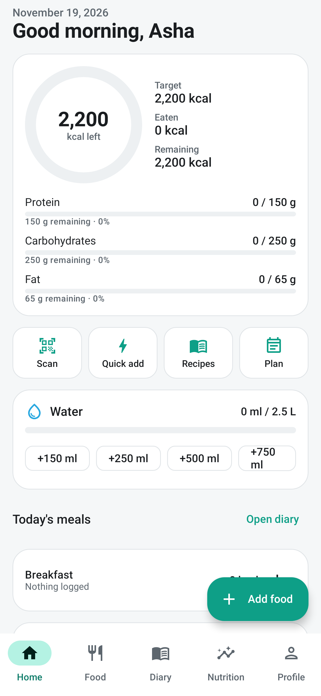
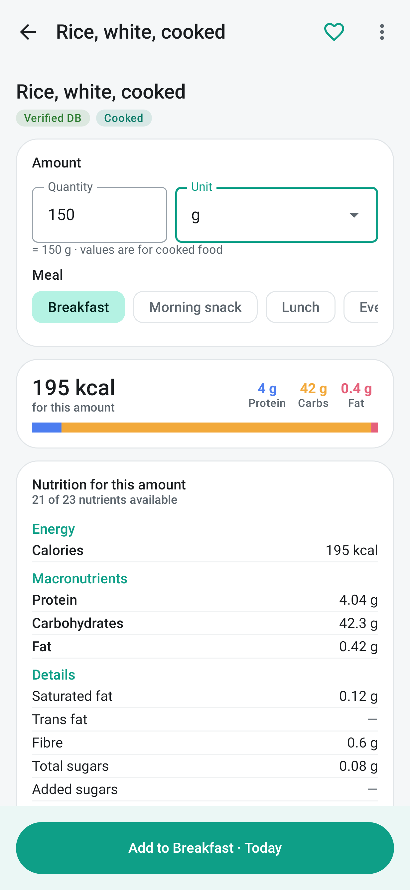
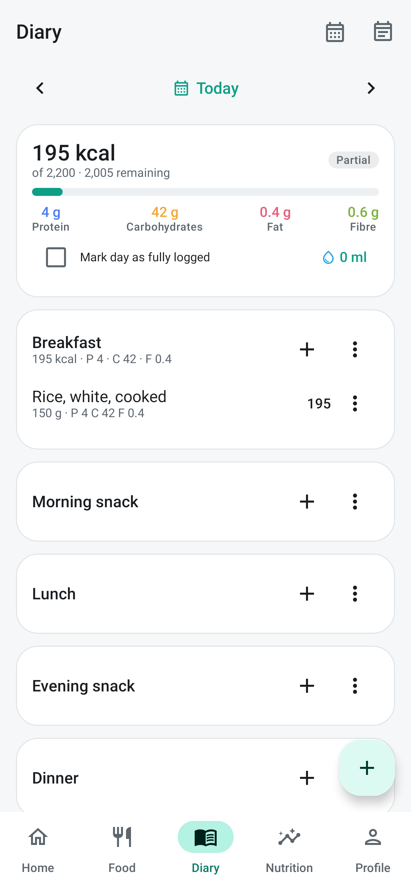
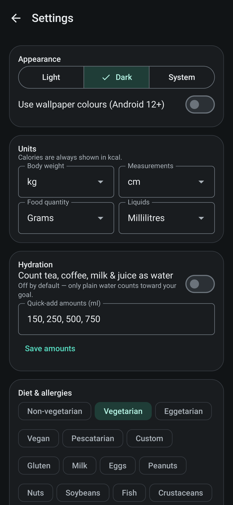

# FDC Nutrition — Android food, calorie & nutrient tracker

A native, offline-first nutrition tracker: **plan your nutrition → record your food → monitor your intake → analyse your progress.**
Kotlin · Jetpack Compose · Material 3 · MVVM / clean architecture · Room · Hilt · Coroutines/Flow · Navigation Compose (type-safe) · WorkManager · CameraX + ML Kit · optional Supabase sync.

| Home | Food detail | Diary | Dark mode |
|---|---|---|---|
|  |  |  |  |

## Highlights
- **12,153 foods offline** from USDA FoodData Central (public domain) incl. Indian dishes, raw/cooked forms and food-specific portion weights; regional search aliases (dahi, chawal, atta…).
- **Accurate maths**: per-100 g/ml scaling with full precision, food-specific household measures (no universal "bowl"), recipes with cooked-weight correction.
- **Missing data is never zero** — partial totals show coverage everywhere (UI, analytics, CSV).
- **History is immutable**: diary entries store nutrition snapshots; editing a food/recipe never rewrites the past.
- Fast logging: suggested meal by time of day, recent/frequent one-tap re-log, saved meals, quick calories, barcode scan.
- Recipes, weekly meal planner (templates, recurrence, explicit "log as eaten"), water, body metrics, calendar, analytics with 7 ranges.
- JSON backup with validated, merge-only restore; CSV export; optional Supabase sync with conflict resolution.

## Project structure
```
core/domain   pure Kotlin: models + calculations (nutrients, units, recipes, targets, analytics)   — JVM unit tests
core/data     Room schema/DAOs, repositories, seeder, Open Food Facts & USDA adapters, backup/CSV, sync engine
app           Compose UI (feature packages under ui/), navigation, Hilt wiring, WorkManager workers
tools/fooddata  reproducible build script for the bundled food database
docs/         schema, data sources, methods, Supabase setup, feature status, screenshots
```

## Requirements
JDK 17+ (built with 21), Android SDK with **platform 37** and build-tools 36. Gradle 9.9.1 via the wrapper; AGP 9.5.1; Kotlin 2.3.21. minSdk 29 (Android 10), targetSdk 36.

## Build & run
```bash
echo "sdk.dir=/path/to/Android/sdk" > local.properties   # or set ANDROID_HOME
./gradlew assembleDebug           # app/build/outputs/apk/debug/app-debug.apk
./gradlew installDebug            # on a connected device/emulator
./gradlew assembleRelease         # R8-minified; signed with the debug key for convenience —
                                  # configure your own signingConfig in app/build.gradle.kts before publishing
```
Open in Android Studio (recent version supporting AGP 9.5) and run the `app` configuration.

## Tests
```bash
./gradlew :core:domain:test :core:data:testDebugUnitTest :app:testDebugUnitTest
```
- `core:domain` – 45 calculation unit tests.
- `core:data` – acceptance scenarios on the real seeded DB, seed/search, migration, sync (Robolectric).
- `app` – Compose UI flows of the real app under Robolectric (onboarding, search → log 150 g rice → edit → recalc, quick add, theme). Screenshots: `app/build/screenshots/`.
See [docs/FEATURE_STATUS.md](docs/FEATURE_STATUS.md) for the 32 acceptance scenarios mapped to tests and known limitations.

## Rebuilding the food database
```bash
# download & unzip SR Legacy (2018-04) and FNDDS survey (2024-10-31) CSVs from https://fdc.nal.usda.gov/download-datasets
python3 -I tools/fooddata/build_seed.py <download_dir> core/data/src/main/assets/seed/foods.seed
```
Bump `FoodSeeder.SEED_VERSION` to upgrade existing installs (seeded rows update in place; user data untouched).

## Documentation
- [Database schema](docs/DATABASE_SCHEMA.md) · [Data sources & licensing](docs/DATA_SOURCES.md) · [Calculation methods](docs/NUTRITION_METHODS.md)
- [Optional Supabase setup](docs/SUPABASE_SETUP.md) · [Completed & outstanding features](docs/FEATURE_STATUS.md)

## Key engineering decisions
- **Wide nullable nutrient columns** (23) instead of an EAV table: fast aggregation, and `NULL` cleanly encodes "unknown".
- **Repositories as concrete classes** in `core:data`; interfaces only where substitution is needed (sync remote, data providers, seed source, clock).
- **Custom Canvas charts** instead of a chart library so unlogged days render as gaps, not zeros.
- **Sync payloads = backup DTOs** (`RecordCodec`), so backup and sync share one validated serialisation path.
- **No telemetry, no account required**; network is used only for barcode lookups, optional online search and optional sync.

Nutrition estimates are informational and not medical advice.
